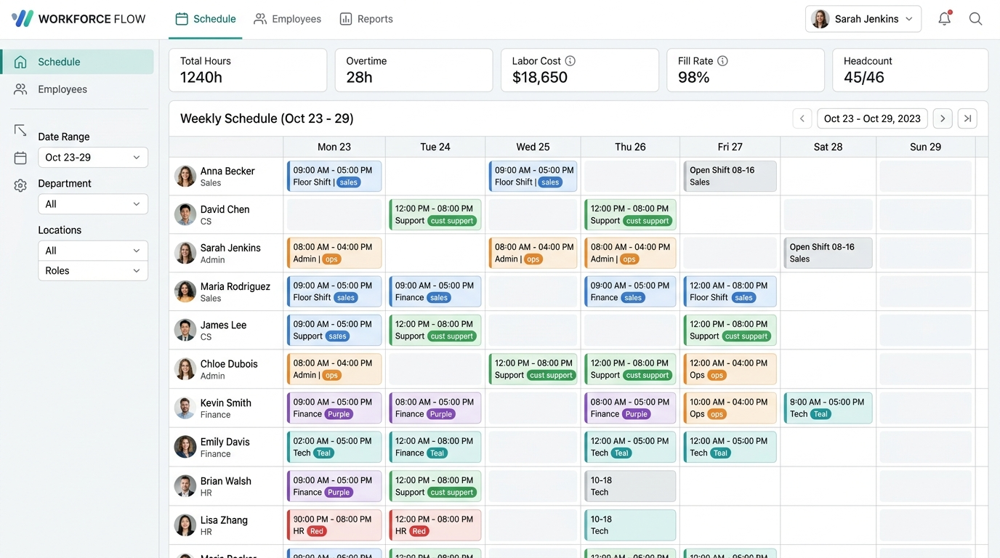

# RosterSync Pro – Staff Roster & Enterprise Ecosystem Hub
*(Personeelsrooster & Ecosysteem Hub)*



> **Bilingual / Meertalig**: [English](#english-documentation) · [Nederlands](#nederlandse-handleiding)

---

## English Documentation

### 🌟 Overview

**RosterSync Pro** is a modern, enterprise-grade staff scheduling and roster management platform designed for shift-based teams, operational departments, and service organizations. Built with React, TypeScript, and Tailwind CSS, it delivers an intuitive weekly drag-and-drop scheduler and a unified data bridge connecting **TalentPulse-HRIS**, **Kopilot-Projects**, and **BoekhoudGemak**.

---

### ✨ Key Features

1. **Interactive Weekly Shift Grid**:
   - Drag-and-drop shift cards across staff members and week days (Monday to Sunday).
   - Real-time weekly contracted hours tracking (e.g. 36h / 40h) with instant overtime and conflict warnings.
   - Quick shift templates (Morning 08:00–16:00, Day 09:00–17:00, Evening 12:00–20:00).
   - Department filtering across Engineering, Operations, Customer Care, and Logistics.

2. **Connected Business Apps Ecosystem Bridge**:
   - **TalentPulse-HRIS**: Automated bidirectional synchronization of employee profiles, contracted weekly hours, and department roles.
   - **Kopilot-Projects**: Direct allocation of shift hours to client deliverables, project milestone codes (e.g. `KOP-101`), and billable budgets.
   - **BoekhoudGemak**: Automatic calculation of regular hours, 150% overtime wage premiums, and one-click payroll timesheet export (CSV & JSON).

3. **Bilingual Support (English & Dutch)**:
   - English is configured as the default standard language.
   - Instant toggle to Dutch (*Nederlands*) across the entire user interface, roster labels, and reports.

4. **SEO & Social Media Optimization**:
   - Comprehensive OpenGraph and Twitter card metadata for **LinkedIn**, **Facebook**, and **Twitter/X**.
   - Includes high-resolution 16:9 banner preview asset (`src/assets/images/rostersync_cover_banner_1794113389294.jpg`).
   - Schema.org `WebApplication` JSON-LD structured data for rich search engine indexing.

---

### 💖 Support & Sponsorship (PayPal)

If you find this project valuable, please consider sponsoring ongoing development:

- **PayPal Account**: [`luciferamorgenster@gmail.com`](mailto:luciferamorgenster@gmail.com)
- **Direct PayPal Link**: [Send Support via PayPal](https://www.paypal.com/cgi-bin/webscr?cmd=_donations&business=luciferamorgenster%40gmail.com&currency_code=EUR)

---

### 🚀 Publish to GitHub

To publish this codebase directly to your GitHub account (`luciferamorgenster@gmail.com`):

```bash
# 1. Initialize git repository
git init

# 2. Stage all files (including bilingual README and cover image)
git add .

# 3. Create initial commit
git commit -m "feat: initial commit of RosterSync Pro with TalentPulse, Kopilot and BoekhoudGemak integrations"

# 4. Set main branch
git branch -M main

# 5. Link your GitHub repository (create 'rostersync-pro' on github.com)
git remote add origin https://github.com/luciferamorgenster/rostersync-pro.git

# 6. Push to GitHub
git push -u origin main
```

---

<br />

## Nederlandse Handleiding

### 🌟 Overzicht

**RosterSync Pro** is een moderne personeelsrooster- en planningsapplicatie ontworpen voor ploegendiensten, operationele afdelingen en projectteams. Gebouwd met React, TypeScript en Tailwind CSS, combineert het een interactief weekrooster met een geautomatiseerde gegevenskoppeling tussen **TalentPulse-HRIS**, **Kopilot-Projects** en **BoekhoudGemak**.

---

### ✨ Hoofdfuncties

1. **Interactief Weekrooster**:
   - Sleep eenvoudig diensten (*drag-and-drop*) tussen medewerkers en weekdagen (maandag t/m zondag).
   - Realtime urenbewaking ten opzichte van de contracturen (bijv. 36u / 40u) met automatische detectie van overuren en dubbele boekingen.
   - Snelmodellen voor diensten (Ochtenddienst 08:00–16:00, Dagdienst 09:00–17:00, Avonddienst 12:00–20:00).
   - Filteren per afdeling (Techniek & IT, Operaties & Support, Klantenservice, Logistiek).

2. **Koppeling met Bedrijfsapplicaties**:
   - **TalentPulse-HRIS**: Synchroniseert personeelsdossiers, contractuele werkuren, afdelingsindelingen en bevoegdheden.
   - **Kopilot-Projects**: Wijst ingeplande diensturen direct toe aan actieve projecttaken, opleveringen en urenbudgetten (bijv. `KOP-101`).
   - **BoekhoudGemak**: Berekent reguliere uren en 150% overurentoeslag en exporteert direct goedgekeurde urenstaten in CSV- en JSON-formaat.

3. **Meertalig (Engels & Nederlands)**:
   - Standaardtaal is Engels, met één klik te wisselen naar het Nederlands voor alle knoppen, statussen en rapportages.

4. **SEO & Social Media Optimalisatie**:
   - Volledige OpenGraph en Twitter card metatags voor **LinkedIn**, **Facebook** en **Twitter/X**.
   - Voorzien van de officiële 16:9 omslagafbeelding (`src/assets/images/rostersync_cover_banner_1794113389294.jpg`).
   - Schema.org `WebApplication` gestructureerde data voor zoekmachines.

---

### 💖 Doneren & Sponsoring (PayPal)

Ondersteun de ontwikkeling en het onderhoud van dit platform:

- **PayPal Rekening**: [`luciferamorgenster@gmail.com`](mailto:luciferamorgenster@gmail.com)
- **Directe PayPal Donatie**: [Doneer via PayPal](https://www.paypal.com/cgi-bin/webscr?cmd=_donations&business=luciferamorgenster%40gmail.com&currency_code=EUR)

---

### 🚀 Publiceren op GitHub

Voer de onderstaande commando's uit in de terminal om dit project te publiceren op het GitHub-account (`luciferamorgenster@gmail.com`):

```bash
# 1. Initialiseer de lokale git repository
git init

# 2. Voeg alle bestanden toe
git add .

# 3. Maak de eerste commit aan
git commit -m "feat: eerste release van RosterSync Pro met koppelingen voor TalentPulse, Kopilot en BoekhoudGemak"

# 4. Stel de main branch in
git branch -M main

# 5. Koppel de remote GitHub repository
git remote add origin https://github.com/luciferamorgenster/rostersync-pro.git

# 6. Push de broncode naar GitHub
git push -u origin main
```

---

### 📄 Licentie
Apache-2.0
